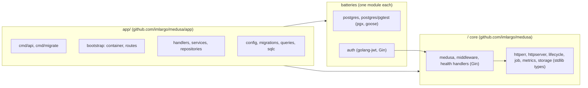
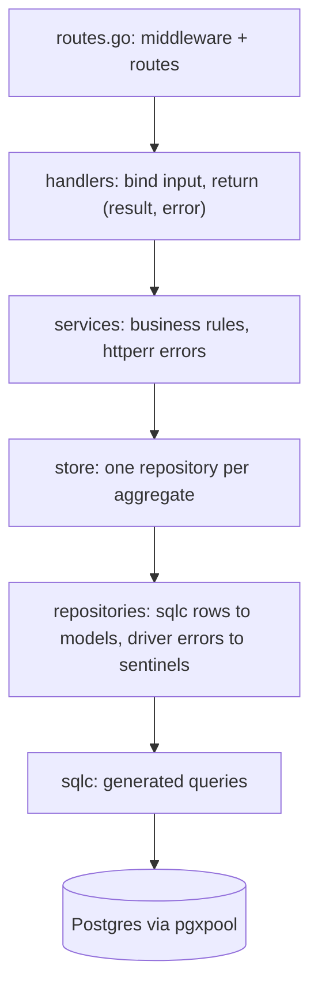
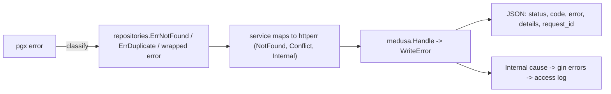
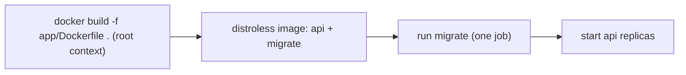

# Architecture

How the system fits together and how it behaves at runtime. Where code goes and how to add things is in [AGENTS.md](../AGENTS.md); why it is laid out this way is in [ADR 0001](adr/0001-separate-medusa-from-the-app.md).

## Modules, one direction



- **The core** knows HTTP, errors, lifecycle, health, metrics and object storage. It knows nothing about users, databases or configuration.
- **The batteries** each wrap one integration: `postgres` the pool, migrations and test databases, `auth` JWT tokens and the middleware. An app pays for a battery's dependencies only if it imports it.
- **The app** owns everything specific to this product: its schema, queries, repositories, config and routes. It imports Medusa's public packages and nothing else from it.
- **Within Medusa**, only the edge (the root package, `middleware` and the health handlers) depends on Gin. The rest takes standard library types.

## Layers inside the app



Each layer only calls the one below it. Types crossing the layers:

- Handlers receive DTOs (`internal/dto`).
- Services and repositories exchange models (`internal/models`).
- Generated `sqlc` types never leave the repositories.

## Startup

`cmd/api/main.go` calls `run`, which builds the app and runs it, and always closes it on the way out.

1. **`config.Load`** reads `.env` when present and the environment, then validates. Every problem is reported in one error, and the process exits without starting anything.
2. **`NewContainer`** opens the dependencies in order:
   - the slog JSON logger
   - the Postgres pool (pinged)
   - the store
   - the JWT signer
   - the SSE broker
   - Redis (optional, pinged)
   - object storage (optional, bucket checked)
   - Prometheus metrics
   - the rate limiter

   If any step fails, everything already opened is closed before the error is returned.
3. The health service registers one check per dependency (database, plus Redis when configured). Services and handlers are built on top of the container.
4. **`newRouter`** builds the Gin engine, and **`httpserver.New`** wraps it.
5. **`lifecycle.New(...).Run`** starts the server and blocks until SIGINT/SIGTERM, context cancellation or a server failure.

The API never migrates the database. Migrations are a separate step (see Deployment).

## Request lifecycle

Middleware runs in this order:

| Order | Middleware | Scope | Effect |
|---|---|---|---|
| 1 | `gin.Recovery` | all | A panic becomes a 500 instead of killing the process |
| 2 | access log | all | One slog line per request, level by status |
| 3 | `middleware.RequestID` | all | Reuses a client `X-Request-ID` only if it is a valid UUID, otherwise generates one; echoed in the response and the body |
| 4 | `middleware.CORS` | all | Configured origins plus the server's own URL |
| 5 | `middleware.BodyLimit` | all | Bodies over `MAX_REQUEST_BODY_BYTES` fail with 413 |
| 6 | `middleware.Metrics` | all, when enabled | Count and duration per route template |
| 7 | `middleware.RateLimit` | `/v1` | 429 over quota; credential endpoints get a tighter rule |
| 8 | `auth.Middleware` | protected `/v1` routes | Valid bearer token (signature, expiry, issuer) required; stores the user ID |

Routes outside `/v1` are deliberately free of auth and rate limiting:

- `/health` and `/ready` keep answering orchestrators while the app sheds load.
- `/metrics` is only registered when metrics are enabled. It should be restricted at the network layer.
- `/docs` is served only when docs are enabled, which is off by default in production.

Inside a route, a `medusa.Handle*` adapter:

1. binds and validates the JSON body (failures become a 400 or a 413);
2. calls the handler;
3. writes either the success envelope or the error.

## Errors



- **Classified errors.** An `*httperr.Error` anywhere in the chain sets the response status and the stable `code`.
- **Context errors.** A canceled request context means the client went away and answers 499. An expired deadline answers 503 with a retry message. Neither counts as a 500.
- **Unclassified errors** become a 500 with a generic message.
- **Internal causes** are added to Gin's error list. The access log prints them in its `error` field; the response body never contains them.
- **Login failures** answer the same 401 whether the email exists or not.

Response shapes (a nil slice in `data` is always sent as `[]`, never `null`):

```json
{"status": 200, "success": true, "message": "ok", "data": {}, "request_id": "..."}
{"status": 404, "code": "NOT_FOUND", "error": "user not found", "request_id": "..."}
```

## Data

| Concern | How |
|---|---|
| Connection | `pgxpool`: 25 max connections, 1 h lifetime, 10 min idle; pinged at startup |
| Schema | goose migrations in `internal/database/migrations`, embedded in the `migrate` binary |
| Queries | Hand-written SQL in `internal/database/queries`, compiled by sqlc into typed Go code |
| Query logging | Every statement in development; statements over 200 ms as warnings in any environment |
| Readiness | `/ready` pings the pool and Redis concurrently, bounded by 5 s |
| Transactions | `store.WithTx(ctx, fn)` gives `fn` a store whose repositories share one transaction; nested calls are savepoints |
| Tests | `pgtest.New(t, migrations.FS)` creates a migrated database per test on `TEST_DATABASE_URL` and drops it afterwards |

The baseline migration (`00001`) matches the table GORM created, so existing databases adopt it without changes. The schema is the single source for both goose and sqlc, so the queries are checked against it at generation time.

## Real-time events

`GET /v1/events` streams server-sent events through `github.com/imlargo/sse`.

- **Authentication.** The stream authenticates itself from the bearer token (header, or `access_token` query for browsers).
- **Scope.** Each user is confined to their own `user.<id>.>` topics.
- **Expiry.** The stream ends when the token expires; the client reconnects and resumes from its cursor.
- **Retention.** Events are kept in memory for 5 minutes. This state is per process (see Scaling).

## Background jobs

Periodic work runs inside the process as a `job.Every`, registered with `lifecycle` like the HTTP server (the app has none yet).

- **No overlap.** A run that outlasts the interval delays the next one.
- **Failures are contained.** Errors and panics are logged with the job name and the schedule continues.
- **Owned shutdown.** On shutdown the run's context is canceled and `lifecycle` waits for it, bounded by the job's stop timeout (10 s by default).
- **Per process.** Every replica runs every job.

## Shutdown

On SIGTERM, `lifecycle` runs this sequence within `SHUTDOWN_TIMEOUT` (10 s by default):

1. **Drain SSE streams.** One third of the budget. Without this step, the HTTP server would wait on streams that never finish.
2. **Stop the servers.** The HTTP server gets the remaining two thirds: in-flight requests finish and new ones are refused. Jobs registered with `lifecycle` are canceled and waited for at the same step.
3. **Close the container in reverse order:** rate limiter, then Redis, then the Postgres pool.

`run` returns every error from these steps joined together, and the process exits non-zero if any occurred.

## Configuration

All configuration comes from environment variables, optionally loaded from a `.env` file that never overrides real variables.

- The full list with defaults is in `app/.env.example`.
- Only `DATABASE_URL` and `JWT_SECRET` are required.
- Production (`APP_ENV=production`) also enables:
  - Gin release mode
  - docs off by default
  - a JWT secret of at least 32 characters
  - no statement logging

## Deployment



- **One image, two binaries.** Migrations run with `--entrypoint /usr/local/bin/migrate` before the new version starts, never from each replica.
- **Build context.** The image builds from the repository root because the app compiles against the Medusa module next to it.
- **Container defaults.** The container listens on `0.0.0.0:8000` and runs as a non-root user.

## Scaling notes

A few pieces of state live inside each process. They are fine for one replica and need attention before running several:

- **Rate limiter counters** are per replica, unless the limiter is moved to a shared store.
- **Background jobs** run on every replica.
- **SSE events and sessions** are in memory: an event published on one replica does not reach a client connected to another.
- **Readiness** checks the database. A database blip therefore takes every replica out of rotation at once.
